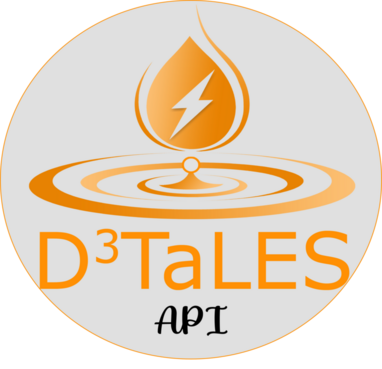

# D<sup>3</sup>TaLES API 



API designed for the [D<sup>3</sup>TaLES project](https://d3tales.as.uky.edu/). Includes 
data processing, database access functions, and property calculators. 

## [Website with full documentation for the D<sup>3</sup>TaLES API can be found here](https://d3tales.github.io/d3tales_api/).  

## Modules
The API keeps four high-level modules:
* `D3database`: Interface for interacting with the D<sup>3</sup>TaLES databases. Includes 
queries, data insertion with validation, and a REST API interface.
* `Processors`: Processing code for extracting data from computational and experimental
data files as well as [ExpFlow](https://d3tales.as.uky.edu/expflow) run objects. 
* `Calculators`: Property calculators and plotters for cyclic voltammetry
* `Workflows`: Fireworks workflow for the D<sup>3</sup>TaLES databases high throughput workflows 

## Installation

Install only the dependencies needed by the part of the API you use:

```bash
pip install "d3tales_api[workflows]"
pip install "d3tales_api[workflows,database]"
pip install "d3tales_api[calculators,processors,database]"
```

`[workflows]` supports local workflows; add `[database]` when using the D3TaLES
REST API or MongoDB. For all standard runtime dependencies and tests, use
`pip install "d3tales_api[all,test]"`. PySCF remains an optional Python
dependency (`pip install "d3tales_api[workflows,pyscf]"`). NLP support can be
added with `pip install "d3tales_api[nlp]"`; ChemDataExtractor2 may need a
separate installation because of its dependency constraints. The existing
`requirements.txt` remains available for legacy environment setup. Gaussian
and ORCA executables are installed and configured separately on FireWorks
workers.

### Environment Variables
Direct database operations require a `DB_INFO_FILE` environment variable
pointing to a JSON file with a `d3tales` connection entry (database name
`d3tales`). Other application databases may have their own entries. An example
can be found at [db_info_ex.json](db_info_ex.json).

To set this variable run:
```bash
export DB_INFO_FILE=$PWD/db_info_ex.json
```
